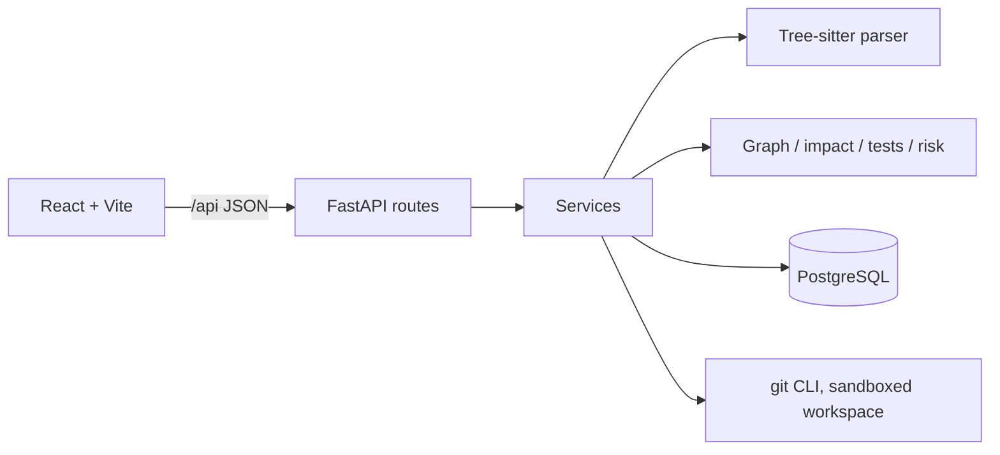
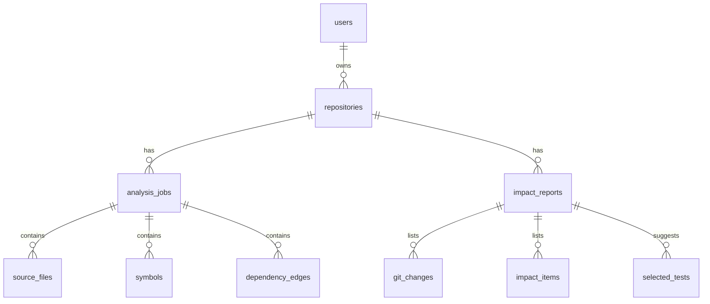

# CodeScope

)

**Intelligent codebase analysis and change-impact engine.** Point it at a Java repository and it parses the source with Tree-sitter, builds a dependency graph, and, given two Git revisions, tells you which classes and methods a change can affect, which tests to run first, and how risky the change is, with the evidence for each answer.

## What it does

- **Parses Java** (classes, interfaces, enums, records, methods, imports, inheritance, calls) with Tree-sitter.
- **Builds a dependency graph** (NetworkX). An edge `A -> B` means A depends on B. Relationships it cannot prove are marked `ambiguous`, `unresolved` or `external`, never guessed.
- **Analyzes Git changes.** Compares two revisions, maps changed lines to symbols, and walks reverse dependencies to find affected code, with the dependency path explaining each result.
- **Selects tests** with a score, a confidence label and plain-language reasons.
- **Scores risk** with a documented rule-based formula. Every factor and its points are shown. There is no machine learning.
- **Web dashboard** (React) with an interactive graph, impact reports, risk chart and history.
- **Accounts**: argon2 password hashing, JWT, per-user repositories.

## Architecture



Routes are thin; business logic lives in `app/services`. `app/parser` and `app/engine` are pure Python with no FastAPI or database imports, so they are unit-tested without a server.

## Data model



Each analysis stores its own snapshot, so a failed run never overwrites the last good result.

## Run it locally

Requirements: Python 3.11+, Node 20+, Git, Docker.

```bash
git clone https://github.com codescope && cd codescope

# database
docker compose up -d db

# backend
cd backend
python3 -m venv .venv && source .venv/bin/activate
pip install -r requirements.txt
cp .env.example .env        # then set SECRET_KEY to a long random value
alembic upgrade head
python -m uvicorn app.main:app --reload --port 8000

# frontend (new terminal)
cd frontend && npm install && npm run dev
```

Open http://localhost:5173, register, add a repository by https URL, and click **Analyze**. Generate a secret with `python -c "import secrets; print(secrets.token_urlsafe(48))"`.

Tests: `cd backend && pytest -q` (needs the `codescope_test` database: `docker compose exec db psql -U codescope -c "CREATE DATABASE codescope_test;"`).

## Evaluation

Method: inject a deliberate bug into a petclinic method, run the real test suite (ground truth), run CodeScope on the same change, and compare. Reproduce with `python ../benchmarks/evaluate_selection.py` from `backend`.

| | Result |
|---|---|
| Mutations with ground truth | 11 (1 skipped: no test detects it) |
| Mean recall, all selected tests | **0.94** |
| Mean selection size | 6.4 of 20 test classes |
| False negatives | 3 |
| Recall using only high+medium confidence | 0.58 |

All three misses were Spring MockMvc or concurrency tests that reach the code through framework routing, which static analysis cannot see. Low-confidence matches carried real signal, so the confidence labels are not yet a reliable cutoff. Full table: `benchmarks/results.md`.

**Limitations.** Small hand-picked sample, not a benchmark. Recall is per test class. Calls on variables of unknown type and chained calls stay unresolved. Reflection and framework wiring are invisible. Only Java is supported.

## Security

- Clones are https-only, with hooks disabled, no submodules, symlinks skipped, and size and time limits; repository code is never executed.
- Passwords hashed with argon2; JWT with expiry; other users' resources return 404.
- Rate limits on login, registration and analysis creation (in process memory; multi-worker deployments need Redis). Request body limit of 64 KB.
- Known trade-offs: registration reveals whether an email exists; the token lives in `sessionStorage`.

## Demo script

1. Register and sign in. 2. Add `https://github.com/spring-projects/spring-petclinic`. 3. Analyze, open the graph, click `Owner` to see what it uses and what uses it. 4. Compare `HEAD~20` to `HEAD`. 5. Walk through changed symbols, affected symbols with their paths, the risk factors and suggested tests. 6. Open `benchmarks/results.md` and discuss the misses.
